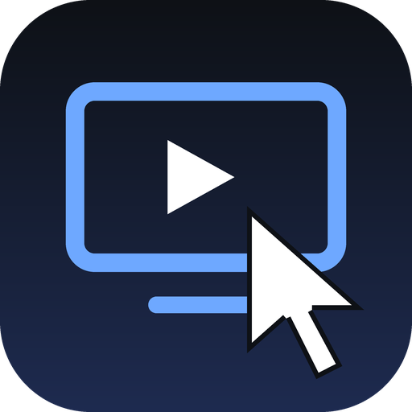
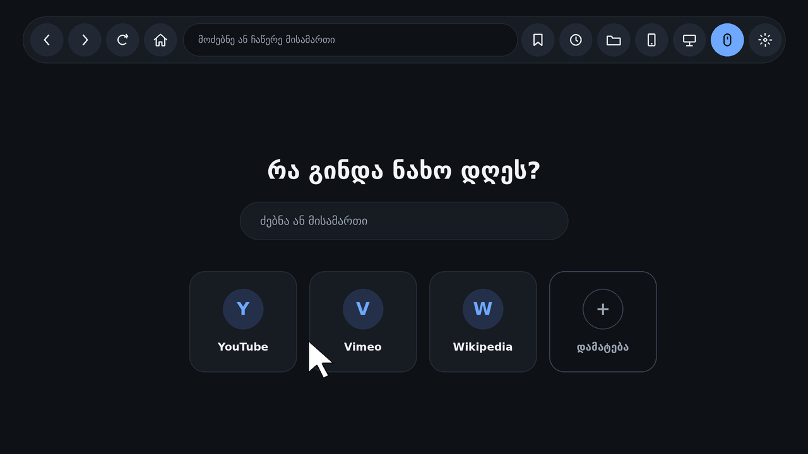
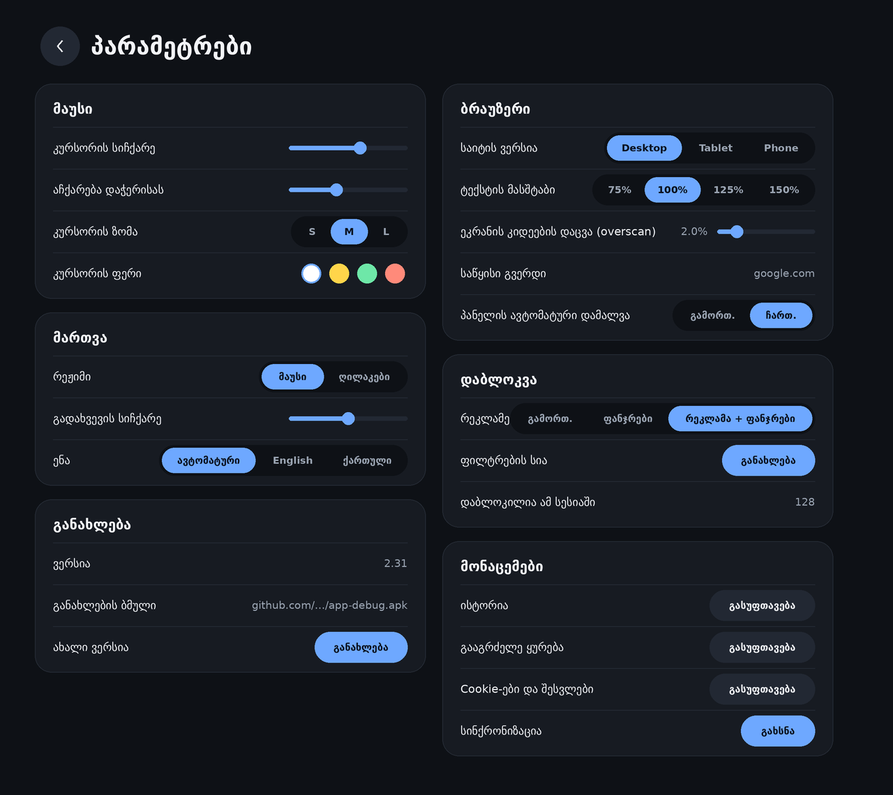
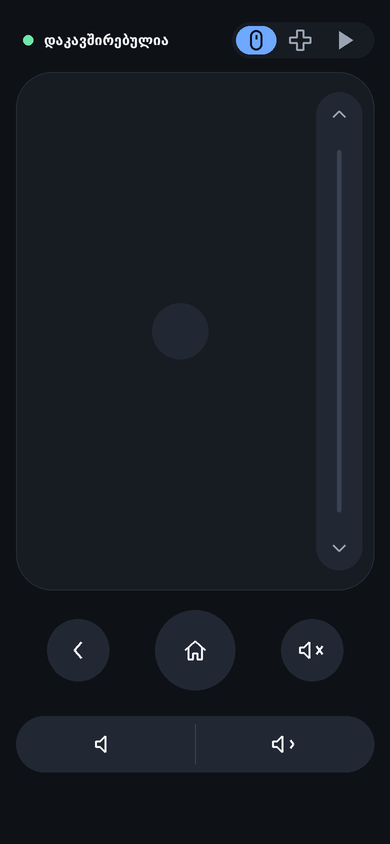

# AvMa TV Browser

[English](README.md) · **ქართული**

მარტივი და თანამედროვე ბრაუზერი **Google TV / Chromecast with Google TV, Android TV და Amazon Fire TV**-ისთვის, შექმნილი ფილმებისა და ვიდეოების დიდ ეკრანზე სანახავად.

| | | |
|---|---|---|
|  |  |  |

*ინტერფეისის ნიმუშები. შეგიძლიათ `docs/images/`-ში რეალური სქრინებით ჩაანაცვლოთ.*

## შესაძლებლობები

- **მართვის ორი გზა:** მაუსის კურსორი, რომელსაც პულტის ისრებით ამოძრავებთ, ან პირდაპირი გადასვლა ღილაკებსა და ბმულებზე.
- **ტელეფონი როგორც პულტი:** დაასკანერეთ QR კოდი და ტელეფონი გახდება ტრეკპადი, კლავიატურა და ხმის პულტი. ტელეფონში აპის დაყენება საჭირო არ არის.
- **საიტის ვერსიები:** გახსენით საიტი Desktop, Tablet ან Phone ვერსიით.
- **ვიდეოს დამხმარე:** როცა გვერდზე ვიდეო მოიძებნება, ბრაუზერი სრულ ეკრანზე გაშვებას შემოგთავაზებთ.
- **საწყისი გვერდი, სანიშნეები და ისტორია** სრულ ფანჯარაში. საიტებს თქვენ ამატებთ, მზა საიტები არ არის.
- **ჩამოტვირთვა და ფაილები:** ჩამოტვირთეთ ფაილი საიტიდან და გახსენით ბრაუზერში (HTML, სურათები, ვიდეო, აუდიო, ტექსტი).
- **სინქრონიზაცია:** ყველა მოწყობილობას თავისი ID აქვს. სხვა მოწყობილობის ID-ის შეყვანით Firebase-ის საშუალებით სანიშნეები და ისტორია გაიზიარება (უფასო გეგმა საკმარისია).
- **განახლება აპიდან** თქვენი GitHub-ის რელიზებიდან.
- **ტელევიზორისთვის მორგებული:** ინტერფეისი ნებისმიერ გაფართოებას ერგება და ეკრანის კიდეების დაშორება (overscan) 0.1%-იანი ბიჯით რეგულირდება, მიმართულებისთვის კი თეთრი კუთხის რკალები ჩნდება.
- **ენები:** ქართული და ინგლისური, პარამეტრებიდან გადართვადი, ახლის [დამატება](docs/TRANSLATING.ka.md) მარტივია.

## ინსტალაცია

1. ააგეთ APK GitHub Actions-ით ან ჩამოტვირთეთ რეპოზიტორიის **Releases** გვერდიდან. იხილეთ [docs/SETUP.ka.md](docs/SETUP.ka.md).
2. ტელევიზორზე დააყენეთ უფასო აპი **Downloader** და გახსენით  
   `github.com/თქვენი-სახელი/თქვენი-რეპო/releases/download/latest/app-debug.apk`
3. პირველი ინსტალაციის შემდეგ განახლება შეგიძლიათ **პარამეტრები → განახლება**.

## გამოყენება

| მოქმედება | მაუსის რეჟიმი | ღილაკების რეჟიმი |
|---|---|---|
| გადაადგილება | ისრები კურსორს ამოძრავებს | ისრები გადადის ბმულებსა და ღილაკებზე |
| კლიკი | OK | OK |
| პანელის გამოჩენა | კურსორი ზემოთ მიიყვანეთ, ან დიდხანს დააჭირეთ OK-ს | პანელი მუდმივად ჩანს; ისარი ზემოთ მასზე გადაგიყვანთ |
| უკან | Back | Back |

ტელეფონით: პანელზე დააჭირეთ **ტელეფონის** იკონს, დაასკანერეთ QR კოდი (იგივე Wi-Fi) და გამოიყენეთ ტრეკპადი. რეჟიმის გადამრთველი ტრეკპადს ისრების წრედ და ბრაუზერის ღილაკებად აქცევს.

## სინქრონიზაცია

გახსენით **პარამეტრები → სინქრონიზაცია**. იქ ჩანს თქვენი ID და მისი QR კოდი. სხვა მოწყობილობაზე ეს ID შეიყვანეთ ველში *სხვა მოწყობილობის დაკავშირება* და დააჭირეთ **დაკავშირებას**. მხოლოდ დაკავშირება არაფერს აკოპირებს: შემდეგ დააჭირეთ **სინქრონიზაცია და შერწყმა** (ორივე მოწყობილობის გასაერთიანებლად) ან **სინქრონიზაცია და არსებულის წაშლა** (ამ მოწყობილობაზე ღრუბლის მონაცემები ჩაჯდება). Firebase-ის მომზადება აღწერილია [docs/SETUP.ka.md](docs/SETUP.ka.md)-ში.

> ID მუშაობს როგორც პაროლი. ვისაც ის აქვს, მასზე შენახულ სანიშნეებსა და ისტორიას წაიკითხავს.

## აგება წყაროდან

პროექტი Android Studio-ს გარეშეც აიგება: ატვირთეთ GitHub-ზე და თან დართული workflow APK-ს ააგებს. შეგიძლიათ Android Studio-შიც გახსნათ და **Run** დააჭიროთ.

## ენები

ტექსტები ინახება ფაილებში `app/src/main/res/values/strings.xml` (ინგლისური) და `values-ka/strings.xml` (ქართული). იხილეთ [docs/TRANSLATING.ka.md](docs/TRANSLATING.ka.md).
