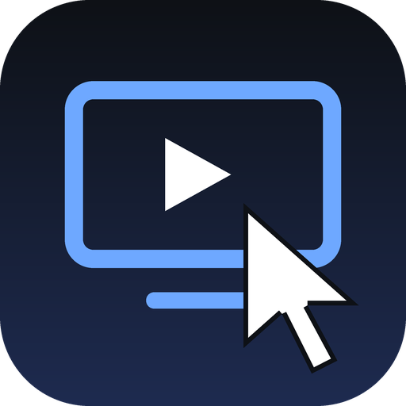
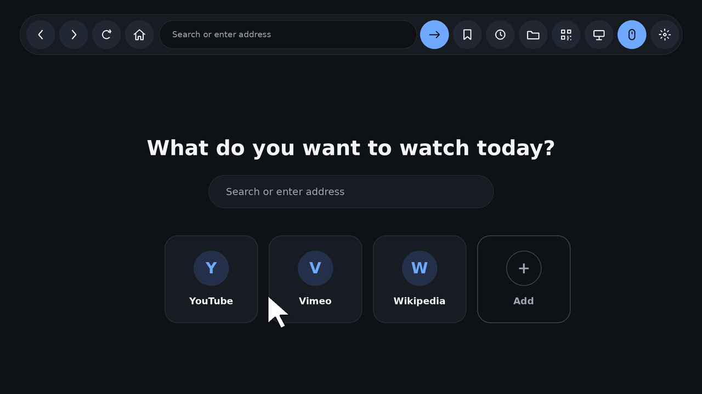
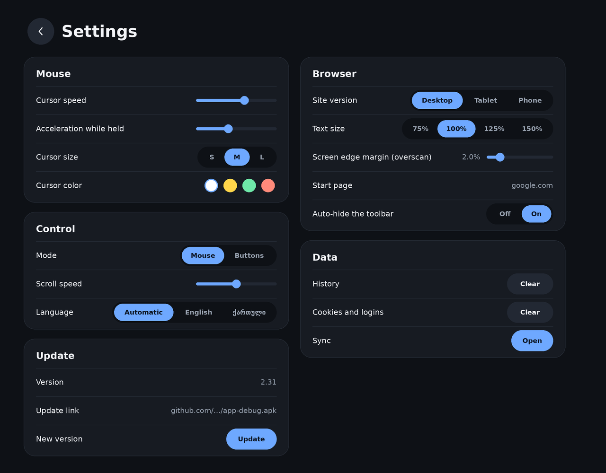
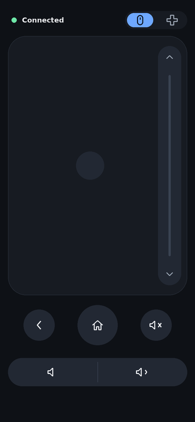
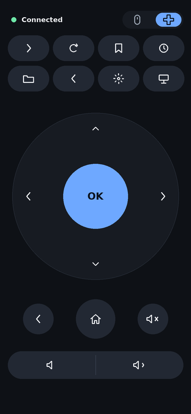

# AvMa TV Browser

**English** · [ქართული](README.ka.md)

A simple, modern web browser for **Google TV / Chromecast with Google TV, Android TV and Amazon Fire TV**, made for watching films and videos on the big screen.

| | |
|---|---|
|  |  |
|  |  |

*UI previews, generated by `tools/make_previews.py`. Replace them with real screenshots in `docs/images/` if you like.*

## Features

- **Two ways to control it:** a mouse cursor you move with the remote's D-pad, or direct button/link navigation.
- **Phone as a remote:** scan a QR code and your phone becomes a trackpad, a keyboard and a volume remote. No app is needed on the phone.
- **Site versions:** open sites as Desktop, Tablet or Phone.
- **Video helper:** when a video is found on a page, the browser offers to play it fullscreen.
- **Start page, bookmarks and history,** all in full-window screens. You add your own sites; there are no preset ones.
- **Downloads and files:** download a file from a website and open it in the browser (HTML, images, video, audio, text).
- **Sync:** every device has its own ID. Enter another device's ID to share bookmarks and history through Firebase (free tier is enough).
- **In-app updates** from your own GitHub releases.
- **TV friendly:** the layout scales to any resolution. The screen-edge margin (overscan) is adjustable in steps of 0.1% with white corner arcs as a guide.
- **Languages:** English and Georgian, switchable in Settings, and it is easy to [add more](docs/TRANSLATING.md).

## Install

1. Build the APK with GitHub Actions or download it from the **Releases** page of your repository. See [docs/SETUP.md](docs/SETUP.md).
2. On the TV, install the free **Downloader** app and open  
   `github.com/YOUR-USER/YOUR-REPO/releases/download/latest/app-debug.apk`
3. After the first install, updates come from **Settings → Update**.

## Using it

| Action | Mouse mode | Buttons mode |
|---|---|---|
| Move | D-pad moves the cursor | D-pad jumps between links and buttons |
| Click | OK | OK |
| Show the toolbar | Move the cursor to the top, or hold OK | Toolbar is always visible; Up reaches it |
| Back | Back | Back |

On your phone: press the **phone** icon in the toolbar, scan the QR code (same Wi-Fi), then use the trackpad. The right-hand mode switch turns the trackpad into a D-pad with the browser buttons.

## Known limitations

- Sites with DRM (Netflix and similar) do not play in a WebView.
- Some embedded players (inside another site's frame) cannot be switched to fullscreen from the prompt; use the player's own fullscreen button.
- The phone volume buttons change the volume of the device running the app. Streaming sticks that use the TV's volume (for example some Fire TV models) ignore it, and the app says so.
- Syncing keeps bookmarks and history in your own Firebase project; a bookmark deleted on one device can come back when merging.

## Sync

Open **Settings → Sync**. Your ID is shown with a QR code. On another device enter that ID under *Connect another device* and press **Connect**. Connecting alone copies nothing: then press **Sync and merge** (combine both devices) or **Sync and replace existing** (this device takes the cloud data). Setup of Firebase is described in [docs/SETUP.md](docs/SETUP.md).

> The ID works like a password. Anyone who has it can read the bookmarks and history stored under it.

## Build from source

The project builds without Android Studio: push it to GitHub and the included workflow builds the APK. You can also open it in Android Studio and press **Run**.

## Languages

Texts live in `app/src/main/res/values/strings.xml` (English) and `values-ka/strings.xml` (Georgian). See [docs/TRANSLATING.md](docs/TRANSLATING.md).
