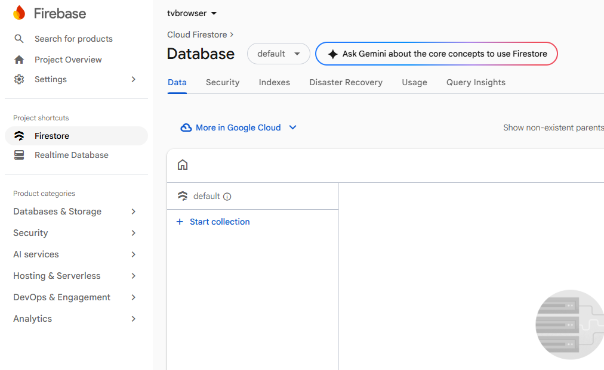
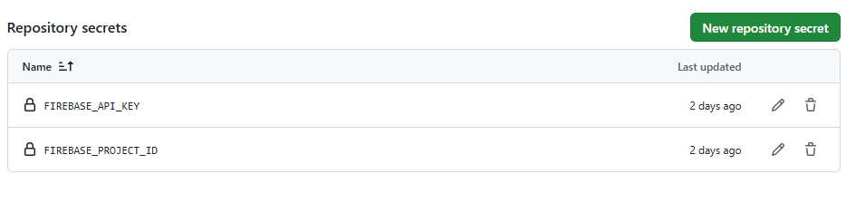

# მომზადების ინსტრუქცია

[English](SETUP.md) · **ქართული**

## 1. პროექტი GitHub-ზე და APK-ს აგება

1. შექმენით **public** რეპოზიტორია და ატვირთეთ პროექტის მთელი საქაღალდე (ფარული `.github` საქაღალდით და `app/tvb.keystore`-ით).
2. გახსენით **Actions** ჩანართი. workflow *Build APK* ყოველ ატვირთვაზე გაეშვება (დაახლოებით 3-5 წუთი).
3. APK გამოჩნდება აქ: **Releases → latest → app-debug.apk**.

## 2. Firebase პროექტის შექმნა (სინქრონიზაციისთვის)

1. გახსენით [Firebase console](https://console.firebase.google.com) და დააჭირეთ **Add project** (Analytics შეგიძლიათ გამორთოთ).
2. გახსენით **Firestore Database** და დააჭირეთ **Create database**. აირჩიეთ production mode და ახლო რეგიონი.

   

3. Firestore-ის **Rules** ჩანართში ჩასვით ეს წესები და დააჭირეთ **Publish**:

   ```
   rules_version = '2';
   service cloud.firestore {
     match /databases/{db}/documents {
       match /tvbrowser/{id} {
         allow get, create, update: if true;
         allow list, delete: if false;
       }
     }
   }
   ```
   დოკუმენტის წაკითხვა მხოლოდ ზუსტი ID-ით შეიძლება და ID-ების სიას ვერავინ ნახავს.
4. **Project settings → General → Your apps → Web (`</>`)**. დაარეგისტრირეთ აპი (ნებისმიერი სახელი). დააკოპირეთ `apiKey` და `projectId`.
5. Google Cloud Console-ში გახსენით **APIs & Services → Credentials**, აირჩიეთ ეს key და *API restrictions*-ში დატოვეთ მხოლოდ **Cloud Firestore API**.

## 3. გასაღებების გადაცემა აგებისთვის

GitHub-ის რეპოზიტორიაში გახსენით **Settings → Secrets and variables → Actions** და დაამატეთ ორი *repository secret*:

| სახელი | მნიშვნელობა |
|---|---|
| `FIREBASE_API_KEY` | მე-2 ნაბიჯის `apiKey` |
| `FIREBASE_PROJECT_ID` | მე-2 ნაბიჯის `projectId` |



workflow მათ აგებას გადასცემს, ამიტომ გასაღებები **შემდეგ** აგებაში მოხვდება. სეკრეტის დამატება უკვე აგებულ APK-ს არ ცვლის. ატვირთეთ ნებისმიერი ცვლილება (ან გაუშვით workflow ხელით) და დააყენეთ ახალი APK.

> გასაღები APK-ში ინახება და მისი ამოღება შესაძლებელია. Firebase-ისთვის ეს ნორმალურია. რეალურ დაცვას Firestore-ის წესები და ზემოთ აღწერილი API შეზღუდვა იძლევა.

> **შეცდომა "The database (default) does not exist"?** აპი ორივეს ცდის: `(default)` და ხელით შექმნილ `default` ბაზას. თუ მაინც ვერ მუშაობს, შეამოწმეთ, რომ ზუსტად ამ პროექტში Firestore ბაზა არსებობს და project ID სეკრეტი სწორია.

## 4. ტელევიზორზე დაყენება

1. **დეველოპერის რეჟიმი:**
   - *Google TV / Chromecast:* Settings → System → About → **Android TV OS build** 7-ჯერ დააჭირეთ.
   - *Fire TV:* Settings → My Fire TV → About → მოწყობილობის სახელზე 7-ჯერ დააჭირეთ. შემდეგ გახსენით **Developer options** და **Downloader**-ს ჩაურთეთ *Install unknown apps*.
2. დააყენეთ **Downloader** და გახსენით APK-ს ბმული:  
   `github.com/თქვენი-სახელი/თქვენი-რეპო/releases/download/latest/app-debug.apk`
3. შემდგომი განახლებები: აპში **პარამეტრები → განახლება**. პირველად Android მოგთხოვთ AvMa TV Browser-ისთვის უცნობი აპების დაყენების დაშვებას.

> აპი ხელმოწერილია `app/tvb.keystore` გასაღებით. თუ ადრე სხვა გასაღებით აგებული ვერსია გქონდათ, ერთხელ წაშალეთ ის და მერე დააყენეთ ახალი.

## 5. ტესტი პლანშეტზე ან ტელეფონზე

ჩამოტვირთეთ APK მოწყობილობის ბრაუზერით და გახსენით. პულტის ლოგიკის შესამოწმებლად შეაერთეთ Bluetooth კლავიატურა (ისრები და Enter პულტის D-pad-ს ცვლის).
