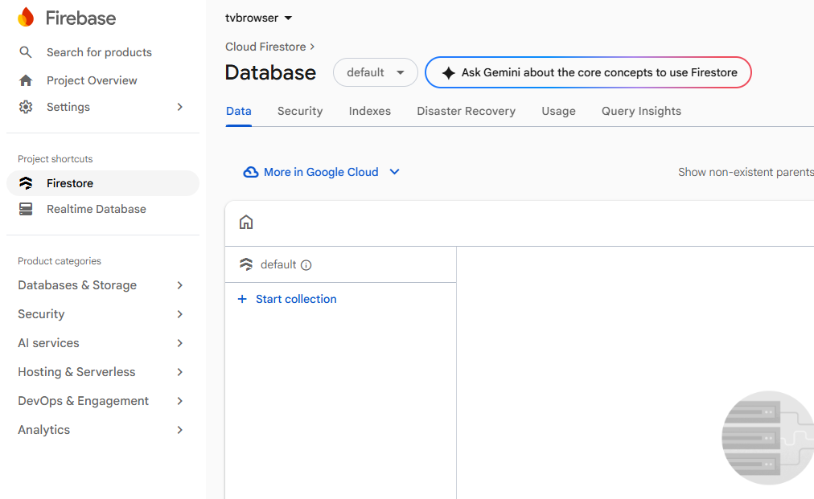
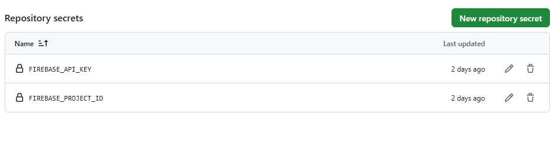

# Setup guide

**English** · [ქართული](SETUP.ka.md)

## 1. Put the project on GitHub and build the APK

1. Create a **public** repository and upload the whole project folder (including the hidden `.github` folder and `app/tvb.keystore`).
2. Open the **Actions** tab. The workflow *Build APK* runs on every push (about 3-5 minutes).
3. The APK appears under **Releases → latest → app-debug.apk**.

## 2. Create the Firebase project (for sync)

1. Open the [Firebase console](https://console.firebase.google.com) and click **Add project** (Analytics can be off).
2. Open **Firestore Database** and click **Create database**. Choose production mode and a region near you.

   

3. In the **Rules** tab of Firestore paste the rules below and press **Publish**:

   ```
   rules_version = '2';
   service cloud.firestore {
     match /databases/{db}/documents {
       match /tvbrowser/{id} {
         allow get, create, update: if true;
         allow list, delete: if false;
       }
     }
   }
   ```
   A document can only be read when you know its exact ID, and nobody can list all IDs.
4. **Project settings → General → Your apps → Web (`</>`)**. Register an app (any name). Copy the `apiKey` and the `projectId`.
5. In the Google Cloud Console open **APIs & Services → Credentials**, select this key and under *API restrictions* allow only **Cloud Firestore API**.

## 3. Give the keys to the build

In your GitHub repository open **Settings → Secrets and variables → Actions** and add two *repository secrets*:

| Name | Value |
|---|---|
| `FIREBASE_API_KEY` | the `apiKey` from step 2 |
| `FIREBASE_PROJECT_ID` | the `projectId` from step 2 |



The workflow passes them to the build, so the **next** build contains them. Adding a secret does not change an APK that was already built. Push any change (or run the workflow manually) and install the new APK.

> The key is stored inside the APK and can be extracted from it. That is normal for Firebase. Real protection comes from the Firestore rules and the API restriction above.

## 4. Install on the TV

1. **Developer options:**
   - *Google TV / Chromecast:* Settings → System → About → tap **Android TV OS build** 7 times.
   - *Fire TV:* Settings → My Fire TV → About → click the device name 7 times. Then open **Developer options** and enable *Install unknown apps* for **Downloader**.
2. Install **Downloader** and open the APK link:  
   `github.com/YOUR-USER/YOUR-REPO/releases/download/latest/app-debug.apk`
3. Later updates: **Settings → Update** inside the app. The first time, Android asks you to allow installing unknown apps for AvMa TV Browser.

> The app is signed with the key in `app/tvb.keystore`. If you installed an older build that used a different signing key, uninstall it once before installing.

## 5. Test on a tablet or phone

Download the APK in the device's browser and open it. To check the remote-control logic, connect a Bluetooth keyboard (arrow keys and Enter replace the D-pad).
